<!-- Profile README for @ostovar04. Upload README.md, assets/, scripts/update_profile_stats.py, and .github/workflows/update-profile-stats.yml to the public repository named exactly ostovar04/ostovar04. -->

<picture>
  <source media="(prefers-color-scheme: dark)" srcset="assets/dark/hero.gif">
  <source media="(prefers-color-scheme: light)" srcset="assets/light/hero.gif">
  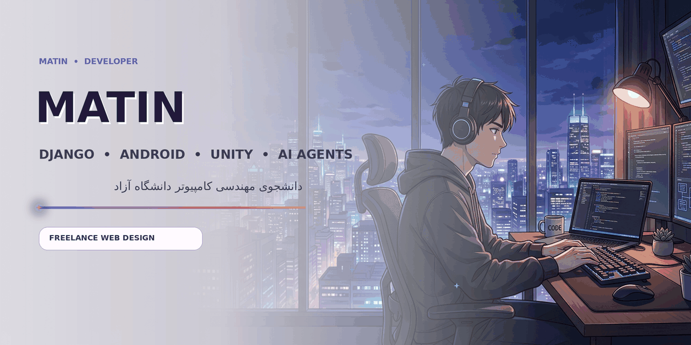
</picture>

🇮🇷 نسخهٔ فارسی — برای خواندن باز/بسته کنید

# سلام، من متین هستم 👋

برنامه‌نویس و دانشجوی **مهندسی کامپیوتر در دانشگاه آزاد اسلامی** هستم. تمرکزم روی توسعهٔ بک‌اند با **Python و Django**، ساخت اپلیکیشن‌های **Android**، پروژه‌های **Unity** و توسعهٔ **ایجنت‌های هوش مصنوعی** است. در کنار برنامه‌نویسی، طراحی وب و فرانت‌اند را به‌صورت پروژه‌ای انجام می‌دهم و با تیمم در بخش بازاریابی و تحویل پروژه همکاری می‌کنم.

## 🧭 حوزه‌های کاری و تخصص‌ها

<picture><source media="(prefers-color-scheme: dark)" srcset="assets/dark/python.svg"><source media="(prefers-color-scheme: light)" srcset="assets/light/python.svg">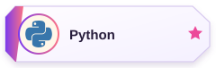</picture>&nbsp;
<picture><source media="(prefers-color-scheme: dark)" srcset="assets/dark/django.svg"><source media="(prefers-color-scheme: light)" srcset="assets/light/django.svg"></picture>&nbsp;
<picture><source media="(prefers-color-scheme: dark)" srcset="assets/dark/backend.svg"><source media="(prefers-color-scheme: light)" srcset="assets/light/backend.svg">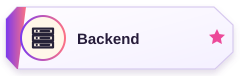</picture>&nbsp;
<picture><source media="(prefers-color-scheme: dark)" srcset="assets/dark/ai-agents.svg"><source media="(prefers-color-scheme: light)" srcset="assets/light/ai-agents.svg">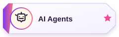</picture>&nbsp;
<picture><source media="(prefers-color-scheme: dark)" srcset="assets/dark/android.svg"><source media="(prefers-color-scheme: light)" srcset="assets/light/android.svg">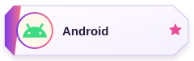</picture>&nbsp;
<picture><source media="(prefers-color-scheme: dark)" srcset="assets/dark/unity.svg"><source media="(prefers-color-scheme: light)" srcset="assets/light/unity.svg">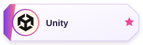</picture>&nbsp;
<picture><source media="(prefers-color-scheme: dark)" srcset="assets/dark/web-design.svg"><source media="(prefers-color-scheme: light)" srcset="assets/light/web-design.svg">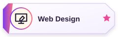</picture>&nbsp;
<picture><source media="(prefers-color-scheme: dark)" srcset="assets/dark/marketing.svg"><source media="(prefers-color-scheme: light)" srcset="assets/light/marketing.svg"></picture>

## 🌱 در حال یادگیری

<picture><source media="(prefers-color-scheme: dark)" srcset="assets/dark/learning-quest.svg"><source media="(prefers-color-scheme: light)" srcset="assets/light/learning-quest.svg">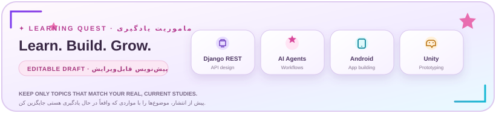</picture>

<picture><source media="(prefers-color-scheme: dark)" srcset="assets/dark/django.svg"><source media="(prefers-color-scheme: light)" srcset="assets/light/django.svg"></picture>&nbsp;
<picture><source media="(prefers-color-scheme: dark)" srcset="assets/dark/ai-agents.svg"><source media="(prefers-color-scheme: light)" srcset="assets/light/ai-agents.svg"></picture>&nbsp;
<picture><source media="(prefers-color-scheme: dark)" srcset="assets/dark/android.svg"><source media="(prefers-color-scheme: light)" srcset="assets/light/android.svg"></picture>&nbsp;
<picture><source media="(prefers-color-scheme: dark)" srcset="assets/dark/unity.svg"><source media="(prefers-color-scheme: light)" srcset="assets/light/unity.svg"></picture>

## 🚀 پروژه‌های شاخص

<table width="100%">
<thead><tr><th width="26%" align="center">پروژه</th><th align="right">شرح · فناوری‌ها</th></tr></thead>
<tbody>
<tr><td valign="top" align="center"><strong><a href="https://github.com/ostovar04/Mazetoori">Mazetoori · مزه</a></strong> 🟢 منتشرشده</td><td dir="rtl" align="right">جست‌وجوی غذای فارسی و رستوران‌های نزدیک در نشان؛ شعاع ۵ کیلومتر و مرتب‌سازی بر اساس فاصله. دادهٔ منوی زنده ندارد. <code>Vite</code> · <code>JavaScript</code> · <code>Three.js</code> · <code>Neshan</code> <a href="https://ostovar04.github.io/Mazetoori/">دموی زنده ↗</a></td></tr>
<tr><td valign="top" align="center"><strong>Django API Hub</strong> 📝 ایدهٔ آینده · قابل‌ویرایش</td><td dir="rtl" align="right">مفهوم پیشنهادی برای ساخت API. <code>Python</code> · <code>Django</code></td></tr>
<tr><td valign="top" align="center"><strong>AI Agent Companion</strong> 📝 ایدهٔ آینده · قابل‌ویرایش</td><td dir="rtl" align="right">ایده‌ای برای گردش‌کار با ایجنت هوش مصنوعی. <code>AI Agents</code> · <code>Automation</code></td></tr>
<tr><td valign="top" align="center"><strong>Android Pocket Utility</strong> 📝 ایدهٔ آینده · قابل‌ویرایش</td><td dir="rtl" align="right">مفهوم یک ابزار کاربردی کوچک. <code>Android</code> · <code>Mobile</code></td></tr>
<tr><td valign="top" align="center"><strong>Unity Interactive Prototype</strong> 📝 ایدهٔ آینده · قابل‌ویرایش</td><td dir="rtl" align="right">مفهوم یک نمونهٔ تعاملی کوتاه. <code>Unity</code> · <code>C#</code></td></tr>
</tbody></table>

## 👥 همکاران

<a href="https://github.com/ndnima/ndnima"><picture><source media="(prefers-color-scheme: dark)" srcset="assets/dark/team-nima.svg"><source media="(prefers-color-scheme: light)" srcset="assets/light/team-nima.svg">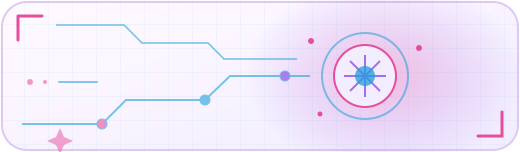</picture></a> 
<strong>نیما دلیر</strong> · <a href="https://github.com/ndnima/ndnima">GitHub</a> حوزهٔ کاری: هوش مصنوعی آفلاین و LLMها، اتوماسیون، بازی‌سازی و طراحی سه‌بعدی.  
<a href="https://github.com/alireza-bokharaei/alireza-bokharaei"><picture><source media="(prefers-color-scheme: dark)" srcset="assets/dark/team-alireza.svg"><source media="(prefers-color-scheme: light)" srcset="assets/light/team-alireza.svg">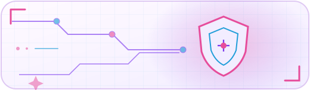</picture></a> 
<strong>علیرضا بخارائی</strong> · <a href="https://github.com/alireza-bokharaei/alireza-bokharaei">GitHub</a> حوزهٔ کاری: توسعهٔ Python، زیرساخت Linux، امنیت سایبری و اتوماسیون هوش مصنوعی آفلاین.

## 📚 کانال‌های آموزشی

<a href="https://www.youtube.com/@nextgen-ain8n"><picture><source media="(prefers-color-scheme: dark)" srcset="assets/dark/youtube-channel.svg"><source media="(prefers-color-scheme: light)" srcset="assets/light/youtube-channel.svg"></picture></a>
<a href="https://t.me/nextgen_ain8n"><picture><source media="(prefers-color-scheme: dark)" srcset="assets/dark/telegram-channel.svg"><source media="(prefers-color-scheme: light)" srcset="assets/light/telegram-channel.svg"></picture></a>

## 📊 آمار GitHub

<picture><source media="(prefers-color-scheme: dark)" srcset="assets/dark/stats-mascot.svg"><source media="(prefers-color-scheme: light)" srcset="assets/light/stats-mascot.svg">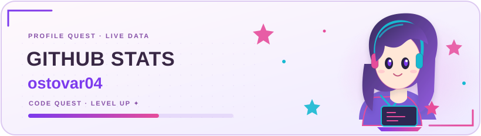</picture> 
<table align="center" width="100%"><tr>
<td width="50%" align="center"><a href="https://github.com/ostovar04"><picture><source media="(prefers-color-scheme: dark)" srcset="assets/dark/github-stats.svg"><source media="(prefers-color-scheme: light)" srcset="assets/light/github-stats.svg">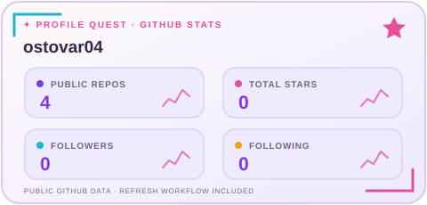</picture></a></td>
<td width="50%" align="center"><a href="https://github.com/ostovar04"><picture><source media="(prefers-color-scheme: dark)" srcset="assets/dark/top-languages.svg"><source media="(prefers-color-scheme: light)" srcset="assets/light/top-languages.svg">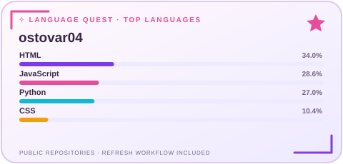</picture></a></td>
</tr></table>

کارت‌ها از داده‌های عمومی GitHub ساخته می‌شوند و workflow روزانهٔ همراه بسته آن‌ها را به‌روزرسانی می‌کند.

## 🏆 گواهی‌نامه‌ها و پیشرفت

قالب‌های قابل‌ویرایش؛ عنوان واقعی، صادرکننده، سال و لینک را با اطلاعات تأییدشده جایگزین کنید.

<picture><source media="(prefers-color-scheme: dark)" srcset="assets/dark/certificate-django.svg"><source media="(prefers-color-scheme: light)" srcset="assets/light/certificate-django.svg">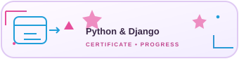</picture>  
<picture><source media="(prefers-color-scheme: dark)" srcset="assets/dark/certificate-ai-agents.svg"><source media="(prefers-color-scheme: light)" srcset="assets/light/certificate-ai-agents.svg">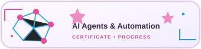</picture>  
<picture><source media="(prefers-color-scheme: dark)" srcset="assets/dark/certificate-android.svg"><source media="(prefers-color-scheme: light)" srcset="assets/light/certificate-android.svg">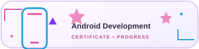</picture>  
<picture><source media="(prefers-color-scheme: dark)" srcset="assets/dark/certificate-unity.svg"><source media="(prefers-color-scheme: light)" srcset="assets/light/certificate-unity.svg">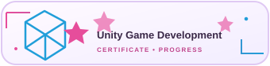</picture>

## 🤝 ارتباط

<a href="https://github.com/ostovar04"><picture><source media="(prefers-color-scheme: dark)" srcset="assets/dark/contact-github.svg"><source media="(prefers-color-scheme: light)" srcset="assets/light/contact-github.svg"></picture></a>
<a href="https://ostovar04.github.io/Mazetoori/"><picture><source media="(prefers-color-scheme: dark)" srcset="assets/dark/contact-portfolio.svg"><source media="(prefers-color-scheme: light)" srcset="assets/light/contact-portfolio.svg"></picture></a>
<a href="mailto:benjaminbigbang24@gmail.com"><picture><source media="(prefers-color-scheme: dark)" srcset="assets/dark/contact-email.svg"><source media="(prefers-color-scheme: light)" srcset="assets/light/contact-email.svg"></picture></a>
<a href="https://t.me/Beagk"><picture><source media="(prefers-color-scheme: dark)" srcset="assets/dark/contact-telegram.svg"><source media="(prefers-color-scheme: light)" srcset="assets/light/contact-telegram.svg"></picture></a>

🇬🇧 English version — open to read

# Hi, I’m Matin 👋

I’m a programmer and **Computer Engineering student at Islamic Azad University**. My focus includes **Python and Django back-end development**, **Android** apps, **Unity** projects, and **AI-agent development**. I also take on freelance website and frontend design, collaborating with my team on marketing and project delivery.

## 🧭 Work Areas & Specialties

<picture><source media="(prefers-color-scheme: dark)" srcset="assets/dark/python.svg"><source media="(prefers-color-scheme: light)" srcset="assets/light/python.svg"></picture>&nbsp;
<picture><source media="(prefers-color-scheme: dark)" srcset="assets/dark/django.svg"><source media="(prefers-color-scheme: light)" srcset="assets/light/django.svg"></picture>&nbsp;
<picture><source media="(prefers-color-scheme: dark)" srcset="assets/dark/backend.svg"><source media="(prefers-color-scheme: light)" srcset="assets/light/backend.svg"></picture>&nbsp;
<picture><source media="(prefers-color-scheme: dark)" srcset="assets/dark/ai-agents.svg"><source media="(prefers-color-scheme: light)" srcset="assets/light/ai-agents.svg"></picture>&nbsp;
<picture><source media="(prefers-color-scheme: dark)" srcset="assets/dark/android.svg"><source media="(prefers-color-scheme: light)" srcset="assets/light/android.svg"></picture>&nbsp;
<picture><source media="(prefers-color-scheme: dark)" srcset="assets/dark/unity.svg"><source media="(prefers-color-scheme: light)" srcset="assets/light/unity.svg"></picture>&nbsp;
<picture><source media="(prefers-color-scheme: dark)" srcset="assets/dark/web-design.svg"><source media="(prefers-color-scheme: light)" srcset="assets/light/web-design.svg"></picture>&nbsp;
<picture><source media="(prefers-color-scheme: dark)" srcset="assets/dark/marketing.svg"><source media="(prefers-color-scheme: light)" srcset="assets/light/marketing.svg"></picture>

## 🌱 Currently Learning

<picture><source media="(prefers-color-scheme: dark)" srcset="assets/dark/learning-quest.svg"><source media="(prefers-color-scheme: light)" srcset="assets/light/learning-quest.svg"></picture>

Editable, unconfirmed suggestions—keep only topics that genuinely match what you are currently learning.

<picture><source media="(prefers-color-scheme: dark)" srcset="assets/dark/django.svg"><source media="(prefers-color-scheme: light)" srcset="assets/light/django.svg"></picture>&nbsp;
<picture><source media="(prefers-color-scheme: dark)" srcset="assets/dark/ai-agents.svg"><source media="(prefers-color-scheme: light)" srcset="assets/light/ai-agents.svg"></picture>&nbsp;
<picture><source media="(prefers-color-scheme: dark)" srcset="assets/dark/android.svg"><source media="(prefers-color-scheme: light)" srcset="assets/light/android.svg"></picture>&nbsp;
<picture><source media="(prefers-color-scheme: dark)" srcset="assets/dark/unity.svg"><source media="(prefers-color-scheme: light)" srcset="assets/light/unity.svg"></picture>

## 🚀 Featured Projects

<table width="100%">
<thead><tr><th width="26%" align="center">Project</th><th align="left">Overview · Stack</th></tr></thead>
<tbody>
<tr><td valign="top" align="center"><strong><a href="https://github.com/ostovar04/Mazetoori">Mazetoori (مزه)</a></strong> 🟢 Published</td><td>Persian-food discovery and nearby Neshan restaurants; 5 km radius, sorted by distance. No live menu data. <code>Vite</code> · <code>JavaScript</code> · <code>Three.js</code> · <code>Neshan</code> <a href="https://ostovar04.github.io/Mazetoori/">Live demo ↗</a></td></tr>
<tr><td valign="top" align="center"><strong>Django API Hub</strong> 📝 Planned concept · editable</td><td>Proposed API project. <code>Python</code> · <code>Django</code></td></tr>
<tr><td valign="top" align="center"><strong>AI Agent Companion</strong> 📝 Planned concept · editable</td><td>Idea for an AI-agent workflow. <code>AI Agents</code> · <code>Automation</code></td></tr>
<tr><td valign="top" align="center"><strong>Android Pocket Utility</strong> 📝 Planned concept · editable</td><td>Concept for a small practical app. <code>Android</code> · <code>Mobile</code></td></tr>
<tr><td valign="top" align="center"><strong>Unity Interactive Prototype</strong> 📝 Planned concept · editable</td><td>Concept for a short interactive prototype. <code>Unity</code> · <code>C#</code></td></tr>
</tbody></table>

## 👥 Collaborators

<a href="https://github.com/ndnima/ndnima"><picture><source media="(prefers-color-scheme: dark)" srcset="assets/dark/team-nima.svg"><source media="(prefers-color-scheme: light)" srcset="assets/light/team-nima.svg"></picture></a> 
<strong>Nima Dalir</strong> · <a href="https://github.com/ndnima/ndnima">GitHub</a> Focus: offline AI/LLMs, automation, game development, and 3D design.  
<a href="https://github.com/alireza-bokharaei/alireza-bokharaei"><picture><source media="(prefers-color-scheme: dark)" srcset="assets/dark/team-alireza.svg"><source media="(prefers-color-scheme: light)" srcset="assets/light/team-alireza.svg"></picture></a> 
<strong>Alireza Bokharaei</strong> · <a href="https://github.com/alireza-bokharaei/alireza-bokharaei">GitHub</a> Focus: Python development, Linux infrastructure, cybersecurity, and offline-AI automation.

## 📚 Educational Channels

<a href="https://www.youtube.com/@nextgen-ain8n"><picture><source media="(prefers-color-scheme: dark)" srcset="assets/dark/youtube-channel.svg"><source media="(prefers-color-scheme: light)" srcset="assets/light/youtube-channel.svg"></picture></a>
<a href="https://t.me/nextgen_ain8n"><picture><source media="(prefers-color-scheme: dark)" srcset="assets/dark/telegram-channel.svg"><source media="(prefers-color-scheme: light)" srcset="assets/light/telegram-channel.svg"></picture></a>

## 📊 GitHub Stats

<picture><source media="(prefers-color-scheme: dark)" srcset="assets/dark/stats-mascot.svg"><source media="(prefers-color-scheme: light)" srcset="assets/light/stats-mascot.svg"></picture> 
<table align="center" width="100%"><tr>
<td width="50%" align="center"><a href="https://github.com/ostovar04"><picture><source media="(prefers-color-scheme: dark)" srcset="assets/dark/github-stats.svg"><source media="(prefers-color-scheme: light)" srcset="assets/light/github-stats.svg"></picture></a></td>
<td width="50%" align="center"><a href="https://github.com/ostovar04"><picture><source media="(prefers-color-scheme: dark)" srcset="assets/dark/top-languages.svg"><source media="(prefers-color-scheme: light)" srcset="assets/light/top-languages.svg"></picture></a></td>
</tr></table>

Generated from public GitHub API data; the included Actions workflow refreshes these cards daily.

## 🏆 Certificates & Progress

Editable certificate placeholders. Replace with verified title, issuer, year, and URL.

<picture><source media="(prefers-color-scheme: dark)" srcset="assets/dark/certificate-django.svg"><source media="(prefers-color-scheme: light)" srcset="assets/light/certificate-django.svg"></picture>  
<picture><source media="(prefers-color-scheme: dark)" srcset="assets/dark/certificate-ai-agents.svg"><source media="(prefers-color-scheme: light)" srcset="assets/light/certificate-ai-agents.svg"></picture>  
<picture><source media="(prefers-color-scheme: dark)" srcset="assets/dark/certificate-android.svg"><source media="(prefers-color-scheme: light)" srcset="assets/light/certificate-android.svg"></picture>  
<picture><source media="(prefers-color-scheme: dark)" srcset="assets/dark/certificate-unity.svg"><source media="(prefers-color-scheme: light)" srcset="assets/light/certificate-unity.svg"></picture>

## 🤝 Contact

<a href="https://github.com/ostovar04"><picture><source media="(prefers-color-scheme: dark)" srcset="assets/dark/contact-github.svg"><source media="(prefers-color-scheme: light)" srcset="assets/light/contact-github.svg"></picture></a>
<a href="https://ostovar04.github.io/Mazetoori/"><picture><source media="(prefers-color-scheme: dark)" srcset="assets/dark/contact-portfolio.svg"><source media="(prefers-color-scheme: light)" srcset="assets/light/contact-portfolio.svg"></picture></a>
<a href="mailto:benjaminbigbang24@gmail.com"><picture><source media="(prefers-color-scheme: dark)" srcset="assets/dark/contact-email.svg"><source media="(prefers-color-scheme: light)" srcset="assets/light/contact-email.svg"></picture></a>
<a href="https://t.me/Beagk"><picture><source media="(prefers-color-scheme: dark)" srcset="assets/dark/contact-telegram.svg"><source media="(prefers-color-scheme: light)" srcset="assets/light/contact-telegram.svg"></picture></a>

---

<!-- Text is bilingual in the animation; replace the URL if the profile repository changes. -->

<a href="https://github.com/ostovar04/ostovar04"><picture><source media="(prefers-color-scheme: dark)" srcset="assets/dark/star-footer.gif"><source media="(prefers-color-scheme: light)" srcset="assets/light/star-footer.gif">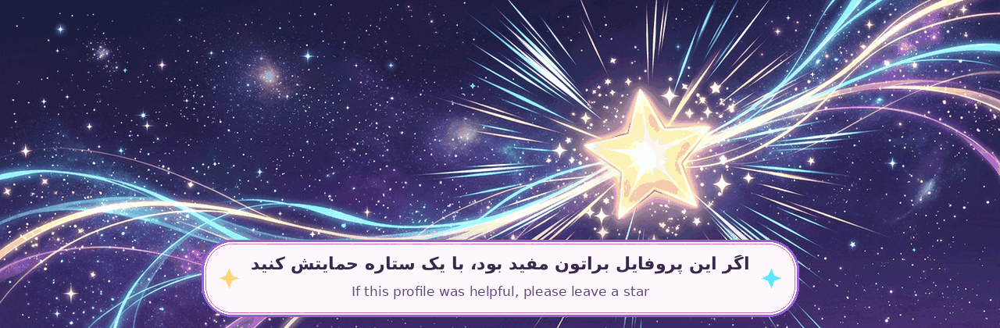</picture></a>

